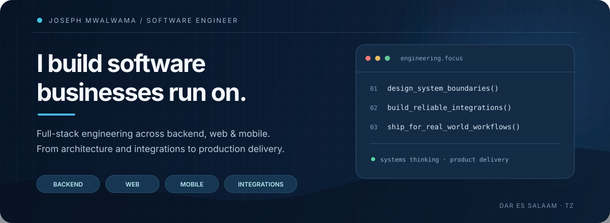
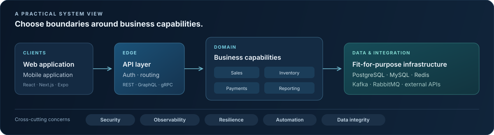

  

  

    <a href="https://mwalwama-joseph.vercel.app">Portfolio</a>
    &nbsp;·&nbsp;
    <a href="https://mwalwama-joseph.vercel.app/projects">Selected work</a>
    &nbsp;·&nbsp;
    <a href="https://mwalwama-joseph.vercel.app/resume">Résumé</a>
    &nbsp;·&nbsp;
    <a href="https://www.linkedin.com/in/joseph-mwalwama-113a18229/">LinkedIn</a>
    &nbsp;·&nbsp;
    <a href="mailto:mwalwamaj@gmail.com">Email</a>
  

  Dar es Salaam, Tanzania · Available for remote collaboration

---

## I build software that businesses run on.

I'm Joseph — a full-stack developer working across backend systems, web applications, mobile products and integrations. I enjoy taking a business problem from its first workflow through architecture, implementation, deployment and ongoing improvement.

My work sits at the intersection of **product engineering and systems engineering**: making software useful to people while keeping the underlying systems dependable, secure and maintainable.

- **Backend:** Java, Spring Boot, Spring Cloud, Python, Django, Laravel
- **Web & mobile:** React, Next.js, TypeScript, React Native, Expo
- **Data & messaging:** PostgreSQL, MySQL, Redis, Kafka, RabbitMQ
- **Platform:** Docker, Kubernetes, Linux, Nginx, Cloudflare, CI/CD
- **Integrations:** payment gateways, institutional billing, REST, GraphQL, gRPC and event-driven workflows

## Selected work

I prefer showing the problem and the system behind a product rather than presenting a wall of technology logos. Each project card links to its case study. Client-sensitive details are intentionally kept private.

  
  
  
  
  
  

  <a href="https://mwalwama-joseph.vercel.app/projects"><strong>Explore all projects →</strong></a>

## Currently building

### Key POS

A point-of-sale and business operations platform for shops, supermarkets and suppliers. The product brings sales, inventory, purchasing and day-to-day operations into one workflow, with web and mobile experiences.

The engineering challenge is not just the feature set: it is making a distributed backend, integrations and real-world shop workflows feel like one coherent product.

## How I approach engineering

Good architecture starts with the problem, not a list of fashionable technologies. I choose boundaries and infrastructure based on workload, failure modes, operational cost and the team's ability to maintain the system.

**The principles I care about:**

- **Clear boundaries:** services and modules own meaningful business capabilities.
- **Data integrity:** explicit transaction boundaries, constraints, idempotency and reliable integration patterns.
- **Resilience:** deliberate timeouts, bounded retries, graceful failure and observable workflows.
- **Security:** least privilege, secure authentication, input validation and careful secret handling.
- **Operability:** useful logs, metrics, traces, health checks and repeatable deployments.
- **Pragmatism:** add infrastructure when a measured requirement justifies its complexity.

## Toolbox

| Area | Technologies |
|---|---|
| Backend engineering | Java · Spring Boot · Spring Cloud · Python · Django · Laravel |
| Web engineering | React · Next.js · TypeScript · JavaScript · Tailwind CSS |
| Mobile engineering | React Native · Expo · NativeWind |
| APIs & integration | REST · GraphQL · gRPC · WebSocket · SSE |
| Data & messaging | PostgreSQL · MySQL · Redis · Kafka · RabbitMQ |
| Infrastructure | Docker · Kubernetes · Linux · Nginx · Cloudflare |
| Delivery | Git · GitHub Actions · CI/CD · Monitoring |

## Writing & ideas

I also write about the engineering decisions and product problems behind the work.

- [Built for when the signal drops](https://mwalwama-joseph.vercel.app/blog/built-for-when-the-signal-drops)
- [Every business has a map](https://mwalwama-joseph.vercel.app/blog/every-business-has-a-map)
- [Your data already knows the answer](https://mwalwama-joseph.vercel.app/blog/your-data-already-knows-the-answer)

[Read all articles →](https://mwalwama-joseph.vercel.app/blog)

---

  <strong>Have a system to build or improve?</strong>

   

  <a href="https://mwalwama-joseph.vercel.app/contact">Let's talk about it →</a>

    

  
    <a href="https://mwalwama-joseph.vercel.app">mwalwama-joseph.vercel.app</a>
    &nbsp;·&nbsp;
    Dar es Salaam, Tanzania
  

  
<strong>GitHub activity</strong>

   
  

    
    
  

---