  

  

    
  

  

    
    
    
    
    
  

  

    
  

  Dar es Salaam, Tanzania · Remote-friendly · Web and mobile engineering

---

## I build software that businesses run on.

I'm Joseph — a full-stack developer working across backend systems, web applications, mobile products and integrations. I take business problems from the first workflow through architecture, implementation, deployment and ongoing improvement.

My work sits at the intersection of **product engineering and systems engineering**: making software useful to people while keeping the underlying systems dependable, secure and maintainable.

- **Backend:** Java, Spring Boot, Spring Cloud, Python, Django, Laravel
- **Web & mobile:** React, Next.js, TypeScript, React Native, Expo
- **Data & messaging:** PostgreSQL, MySQL, Redis, Kafka, RabbitMQ
- **Platform:** Docker, Kubernetes, Linux, Nginx, Cloudflare, CI/CD
- **Integrations:** payment gateways, institutional billing, REST, GraphQL, gRPC and event-driven workflows

  

## Selected work

These case studies show the products, workflows and systems I've helped build. Client-sensitive details stay private.

  
  
  
  
  
  

  <a href="https://mwalwama-joseph.vercel.app/projects"><strong>Explore all projects →</strong></a>

## Currently building · Key POS

A point-of-sale and business operations platform for shops, supermarkets and suppliers. It brings sales, inventory, purchasing and daily operations into one workflow across web and mobile.

The engineering challenge is making a distributed backend, integrations and real-world shop workflows feel like one coherent product.

## How I approach engineering

Good architecture starts with the problem, not a list of fashionable technologies. I choose boundaries and infrastructure based on workload, failure modes, operational cost and the team's ability to maintain the system.

- **Clear boundaries:** services and modules own meaningful business capabilities.
- **Data integrity:** explicit transaction boundaries, constraints, idempotency and reliable integration patterns.
- **Resilience:** deliberate timeouts, bounded retries, graceful failure and observable workflows.
- **Security:** least privilege, secure authentication, input validation and careful secret handling.
- **Operability:** useful logs, metrics, traces, health checks and repeatable deployments.
- **Pragmatism:** add infrastructure when a measured requirement justifies its complexity.

## Toolbox

I kept the visual technology stack because it makes the tools I work with immediately scannable.

  
   
  
   
  

## Contributions in 3D

  

## Writing & ideas

- [Built for when the signal drops](https://mwalwama-joseph.vercel.app/blog/built-for-when-the-signal-drops)
- [Every business has a map](https://mwalwama-joseph.vercel.app/blog/every-business-has-a-map)
- [Your data already knows the answer](https://mwalwama-joseph.vercel.app/blog/your-data-already-knows-the-answer)

[Read all articles →](https://mwalwama-joseph.vercel.app/blog)

  
<strong>📊 More GitHub stats</strong>

   
  

    
    
  

  

    
  

  

    
  

---

  <picture>
    <source media="(prefers-color-scheme: dark)" srcset="https://raw.githubusercontent.com/ugaly/ugaly/output/github-snake-dark.svg" />
    <source media="(prefers-color-scheme: light)" srcset="https://raw.githubusercontent.com/ugaly/ugaly/output/github-snake.svg" />
    
  </picture>

  **Have a system to build or improve?**

  <a href="https://mwalwama-joseph.vercel.app/contact">Let's talk →</a>

    

  
    <a href="https://mwalwama-joseph.vercel.app">mwalwama-joseph.vercel.app</a>
    &nbsp;·&nbsp;
    Dar es Salaam, Tanzania
  

