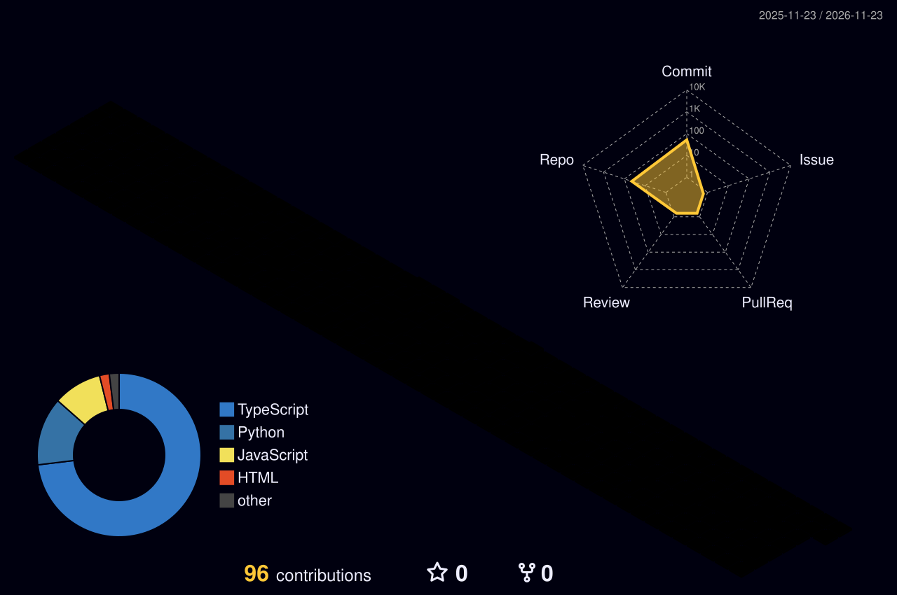

  

  
  
  
  
  

  

 

  

 

<h2 align="center">Now launching</h2>

  

<h2 align="center">Selected work</h2>

Every card opens the full case study on my portfolio. Client data stays private, so each one shows the system flow.

  
  
  
  
  
  

<a href="https://mwalwama-joseph.vercel.app/projects"><b>All projects →</b></a>

 

<h2 align="center">How I build</h2>

  

I use Claude Code and Cursor every day, so a solo build can move at team speed without cutting quality.

 

<h2 align="center">Toolbox</h2>

   
   
  

 

<h2 align="center">Contributions in 3D</h2>

  

  
<b>📊 More GitHub stats</b>

   
  

    
    
  

  

    
  

  

    
  

 

<h2 align="center">Writing</h2>

  <a href="https://mwalwama-joseph.vercel.app/blog/built-for-when-the-signal-drops">📶 Built for when the signal drops</a> &nbsp;·&nbsp;
  <a href="https://mwalwama-joseph.vercel.app/blog/every-business-has-a-map">🗺️ Every business has a map</a> &nbsp;·&nbsp;
  <a href="https://mwalwama-joseph.vercel.app/blog/your-data-already-knows-the-answer">📈 Your data already knows the answer</a>

<a href="https://mwalwama-joseph.vercel.app/blog"><b>Read the blog →</b></a>

 

  <picture>
    <source media="(prefers-color-scheme: dark)" srcset="https://raw.githubusercontent.com/ugaly/ugaly/output/github-snake-dark.svg"/>
    <source media="(prefers-color-scheme: light)" srcset="https://raw.githubusercontent.com/ugaly/ugaly/output/github-snake.svg"/>
    
  </picture>

<h3 align="center">Have a system to build? <a href="https://mwalwama-joseph.vercel.app/contact">Let's talk →</a></h3>

Dar es Salaam, Tanzania · remote-friendly · <a href="https://mwalwama-joseph.vercel.app">mwalwama-joseph.vercel.app</a>

