<!-- ============ HEADER ============ -->

  

  

  
  
  
  

 

<!-- ============ TERMINAL INTRO ============ -->

  

## ⚡ About

I build production systems end to end — from Spring Boot microservices and event-driven backends to the web and mobile apps people actually use. Most of my work sits where software meets money and operations: **payment gateways, POS & inventory, fleet tracking, and ERP integrations**.

- 🏗️ **Architecture** — microservices, API gateways, Kafka/RabbitMQ eventing, Redis caching, Docker & Kubernetes
- 💳 **Payments** — CRDB institutional bill integration, Selcom, mobile money flows
- 📱 **Product** — web (Next.js) + mobile (Expo) + backend shipped as one coherent system
- 🤖 **AI-assisted** — Claude Code & Cursor are part of my daily workflow for faster, cleaner delivery
- 🔭 **Now** — launching **[Key POS](https://keypos.store)**, a multi-branch POS & inventory platform (web, mobile, POS terminal) · Dec 2026

## 🧰 Tech Stack

  <b>Backend & Messaging</b>  
  

  <b>Frontend & Mobile</b>  
  

  <b>Data, Infra & Tooling</b>  
  

## 🚀 Featured Work

| Project | What it is | Stack |
|---|---|---|
| 🧾 **Key POS** | POS & inventory for multi-branch businesses — stock transfer, counting, role-based apps, POS terminal support | Spring Boot microservices · Next.js · Expo |
| 💳 **Payment Integrations** | CRDB institutional bill integration & Selcom gateway flows | Spring Boot · REST · webhooks |
| 🏛️ **E-Valuation Board** | Backend platform and web portals for valuation workflows | Spring Boot · React |
| 🚚 **JZA Tracking** | Fleet & transport management | Java · React |
| 📊 **Silent Ocean / Lepont** | Sales-member applications and operational dashboards | React · Spring Boot |
| 🪪 **AtomCard** | NFC-enabled digital business cards | React · Vite · shadcn/ui |

## 📈 GitHub Activity

  
  

  

  

## 🐍 Contribution Snake

  <picture>
    <source media="(prefers-color-scheme: dark)" srcset="https://raw.githubusercontent.com/ugaly/ugaly/output/github-snake-dark.svg"/>
    <source media="(prefers-color-scheme: light)" srcset="https://raw.githubusercontent.com/ugaly/ugaly/output/github-snake.svg"/>
    
  </picture>

## 🤝 Work with me

Open to freelance and remote engagements — backend platforms, payment integrations, POS/ERP systems, and full web + mobile products.

  
  

